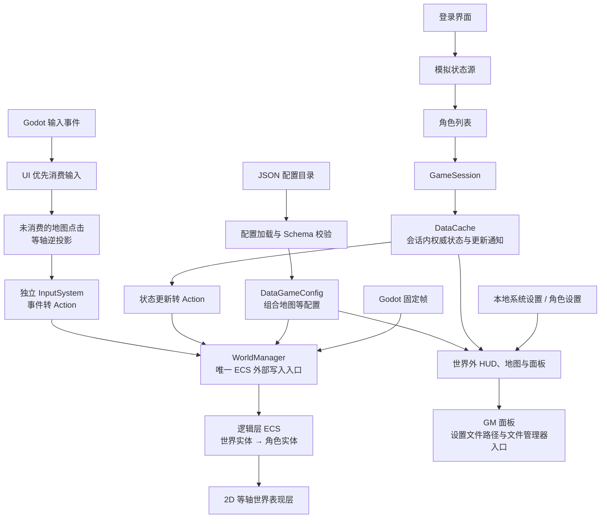

# 首期数据驱动 RPG 客户端计划

本文将首期客户端方案与后续确认的调整汇总为一份可独立阅读的计划。当前实现状态以 `docs/architecture.md`、`docs/roadmap.md`、`openspec/specs/` 和代码为准。

## 目标与边界

使用 Godot 4.7.2 .NET 和 C# 构建 Windows 桌面网络 RPG 客户端的首期架构，先由模拟状态源代替服务器。配置、会话状态、ECS 逻辑、世界表现、输入路由、世界外 UI 和本地设置各有明确边界。世界采用 2D 等轴视角，地图逻辑坐标保持独立。

首期不实现真实网络连接、寻路、技能释放、背包操作、正式美术资源或 GM 权限功能；职业、故事和战斗规则仍待确定。

## 总体结构

`InputSystem` 独立于世界，UI 先消费自己的输入。未被 UI 消费的地图点击经等轴逆投影转换为逻辑坐标，再成为移动 Action。`WorldManager` 只接受 Action；输入和模拟源均不能直接修改 ECS。`DataCache` 保存模拟源返回的当前权威状态，ECS 保存世界逻辑状态。角色可即时预测移动，模拟源的确认或修正经 `DataCache → Action` 进入 ECS。

## 首期功能

### 配置与地图

- 启动时递归加载配置目录中的全部 JSON，以 JSON Schema Draft 2020-12 校验，再组合为 `DataGameConfig`；未知类型、重复类型或无效配置明确报错。
- 示例地图为 `1000×1000` 格，默认瓦片尺寸为 32 逻辑像素，配置默认地块和稀疏覆盖格。
- `MapManager` 封装地图读取、边界和可见格范围。世界表现将逻辑坐标投影为 2:1 等轴菱形，仅绘制视口附近地块，不为一百万个瓦片逐个创建节点。雷达和大地图仍读取逻辑地图坐标。

### 登录与会话

- 演示账号为 `demo / demo`，支持成功与失败结果。登录成功返回至少两个不同 `role_id` 的角色。
- 选角后创建 `GameSession` 及对应角色的 `DataCache`；切换角色释放旧会话并建立新会话。后续真实网络实现应替换状态源，不改变 UI 与 ECS 的数据边界。

### ECS 世界与输入

- 轻量自建实体、组件、系统和 Action 队列，由 Godot 固定帧驱动。进入游戏先创建地图世界实体，再由会话数据创建角色实体。
- 独立 `InputSystem` 负责将未被 UI 消费的鼠标点击转换为移动 Action。地图点击先从等轴画布坐标还原为逻辑坐标；角色直线移动，连续点击立即更新目的地，目的地限制在地图边界内。
- 角色与摄像机使用相同等轴投影。模拟状态源延迟确认或修正位置，客户端按序号处理并将修正经 Action 应用于 ECS。

### 世界外 UI

- 角色头像及等级、生命值、魔力值、经验值位于左上角；小地图雷达位于地图画面右上角；底部默认显示一条 9 格技能栏。
- 右下菜单顺序为**角色、背包、大地图、GM、系统**。角色面板显示示例属性；背包和技能格保持空状态；大地图显示当前位置；系统面板用于调整设置。
- GM 面板显示系统设置文件和当前角色设置文件的绝对路径。点击对应按钮时，文件存在则在桌面文件管理器中定位该文件；文件缺失则打开其父目录。GM 首期没有独立设置文件，后续若需要 GM 设置，应与系统设置、角色设置分开建模和持久化。
- HUD、地图面板和 GM 面板独立于 ECS 世界，游戏数据来自 `DataGameConfig` 与 `DataCache`。

### 本地设置

- 本地设置独立于游戏配置和会话缓存。系统设置保存于 Godot `user://settings/system.json`，角色设置按 `role_id` 保存于 `user://settings/roles/<role_id>.json`；文件缺失时使用默认值。
- 系统设置分为“显示”和“声音”页签，至少可调整分辨率与主音量。
- 角色设置提供 HUD 页签：三条技能栏各 9 格，默认只显示第一条，可开启第二、三条。HUD 调整模式可拖动技能栏、菜单按钮条和角色头像；位置按相对屏幕坐标保存，限制在可视区域内，并可恢复默认布局。

## 实施顺序与验收

首期按“配置加载 → 登录会话 → ECS 与地图 → 移动同步 → UI → 设置持久化”实施；等轴视角与 GM 面板作为后续已完成的扩展。开发位于 `develop`，运行代码与功能测试使用 C#。对应 OpenSpec change 已归档，当前能力以主规格为准。

- [x] 配置加载、Schema 校验及文件相关错误诊断。
- [x] 登录成功、失败、角色隔离和会话切换。
- [x] 世界实体先于角色实体创建；连续点击改目的地；权威修正经 Action 生效。
- [x] 等轴坐标往返、角色投影和地图点击逆投影。
- [x] HUD、雷达、基础面板、GM 菜单顺序及设置路径显示。
- [x] 系统设置持久化、不同角色 HUD 设置隔离。
- [x] `tools/check.ps1`、C# 功能测试和 Godot 无界面场景测试。
- [ ] Windows 桌面手动走通完整流程，尤其确认 GM 按钮实际打开文件管理器并定位文件。

## 已定默认与待定事项

演示账号为 `demo / demo`；示例地图为 `1000×1000` 格，每格 32 逻辑像素；配置文件随客户端打包。配置异常时报告错误，本地设置文件缺失时回退默认值。GM 设置的具体内容、权限模型和持久化格式尚未确定，不作为首期能力。
